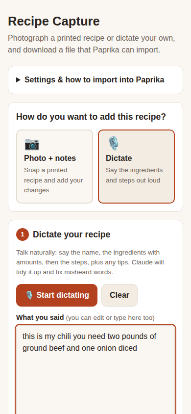

# Recipe Capture for Paprika

Get recipes from printed family cookbooks, or from your own head, into the [Paprika](https://www.paprikaapp.com/) recipe app.

- **📷 Photo + notes:** photograph a printed or handwritten recipe and type what you changed ("half the sugar, baked 40 min"). Claude reads the page into a proper recipe and keeps your changes in Paprika's Notes.
- **🎙️ Dictate:** talk through the ingredients and steps. Claude turns your words into a tidy recipe, fixing misheard words without adding anything you didn't say.

You review and edit everything, then download a `.yml` file that Paprika imports, either one recipe at a time or a whole batch at once.

> This is a personal project. It isn't affiliated with or endorsed by the makers of Paprika.

## What you need

- A free **GitHub** account to host your own copy (free, about 5 minutes to set up).
- An **Anthropic API key** so Claude can read your photos and dictation. It's pay-as-you-go: each recipe costs a few cents, so $5 of credit covers well over a hundred recipes.
- The **Paprika** app (any version: iPhone/iPad, Mac, Windows or Android).

## Set up your own copy

### 1. Copy this repository
1. Sign in to GitHub and click **Fork** at the top of this page. (If you see **Use this template**, that works too.)
2. Keep the repository **public**. Free GitHub accounts only publish websites from public repositories. Nothing private ever goes in it (see [Privacy](#privacy-and-security)).

### 2. Turn on GitHub Pages
1. In your copy, go to **Settings → Pages**.
2. Under **Build and deployment**, set **Source** to *Deploy from a branch*.
3. Set **Branch** to `main` and the folder to `/ (root)`, then click **Save**.
4. Wait 2–5 minutes. Your app is then at:
   `https://YOUR-GITHUB-USERNAME.github.io/recipe-capture/`

### 3. Get an Anthropic API key
1. Go to [console.anthropic.com](https://console.anthropic.com/) and sign in or create an account.
2. Under **Billing**, add a payment method and a small amount of credit, e.g. $5.
3. **Recommended:** set a monthly spending limit (e.g. $10), so a lost key can never cost much.
4. Under **API Keys**, click **Create Key** and copy it. It starts with `sk-ant-` and is only shown once.

### 4. Open the app on your phone
1. Open your app's address in Safari or Chrome.
2. Tap **Settings & how to import into Paprika** and paste your API key.
3. **Optional:** add it to your home screen (**Share → Add to Home Screen**) so it opens like an app.

## Using it

1. Choose **📷 Photo + notes** or **🎙️ Dictate**.
2. **Photo:** take one photo per page, type your changes, then tap **✨ Read recipe from photos**.
   **Dictate:** tap **🎙️ Start dictating**, talk, and tap **Stop**. Then tap **✨ Turn into recipe**. If the mic button doesn't work in your browser, tap in the text box and use your keyboard's microphone instead.
3. Check the filled-in recipe. Anything Claude wasn't sure about is listed in a yellow box.
4. Tap **⬇️ Download this recipe**, or use **➕ Add to batch** to collect several and download them together.

### Importing into Paprika
- **iPhone/iPad:** the file goes to **Files → Downloads**. Press and hold it, tap **Share**, and choose **Paprika**. You can also use Paprika's **Settings → Import**.
- **Mac/Windows:** in Paprika, choose **File → Import** and pick the `.yml` file.

Imported recipes sync to your other devices through Paprika Cloud Sync, if you use it.

## Privacy and security

- **Your API key stays on your device.** It's saved only in your browser and is sent only to Anthropic (`api.anthropic.com`). It is never written into this repository. Anyone who opens your copy of the app sees an empty key box and would have to use their own key.
- **Your recipes and photos aren't stored on GitHub.** They stay in your browser until you download the file. Photos and dictation are sent to Anthropic only when you tap the ✨ button.
- **Never commit a key to the repository.** If a key ever leaks, delete it in the Anthropic console and create a new one.
- **Anyone using your phone's browser can use the saved key.** On a shared device, clear it from Settings when you're done.

## Troubleshooting

| Problem | Fix |
|---|---|
| 404 page | Wait a few minutes after turning on Pages. Check that the repository is **public** and that the address ends in `/recipe-capture/`. |
| "Your API key was rejected" | Re-copy the key from the Anthropic console into Settings. |
| "Too many requests… or out of credit" | Add credit under **Billing** in the Anthropic console. |
| Mic button does nothing | Allow microphone access for the site in your browser settings, or use your keyboard's microphone. |
| Paprika won't import the file | Make sure the recipe has a name, ingredients and directions. |

## How it works

This is a plain static website with no server and no build step:

| File | Purpose |
|---|---|
| `index.html` | Page layout and styles |
| `app.js` | Photos, dictation, the Claude request, saving drafts and batches in your browser |
| `paprika.js` | Writes Paprika's YAML import format |
| `vendor/anthropic-sdk.js` | The official [Anthropic TypeScript SDK](https://github.com/anthropics/anthropic-sdk-typescript) (v0.128.0, MIT license), bundled so the page loads nothing from other sites |

It uses the `claude-opus-5` model. To use a different one, change `MODEL` at the top of `app.js`.

## License

MIT. See [LICENSE](LICENSE).
